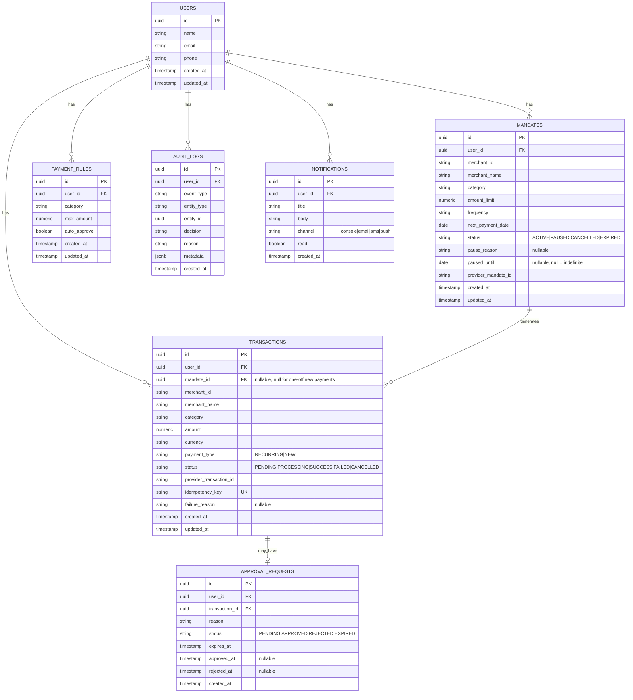
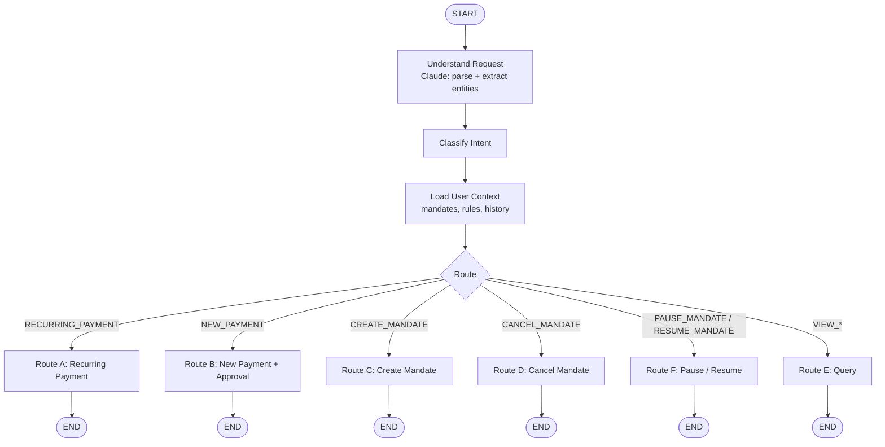

# AI Agentic UPI Payment Assistant — Phase 0: Architecture

Status: **DRAFT — awaiting your approval before Phase 1**

---

## 0. USP — "Pause without cancelling"

**The problem:** UPI AutoPay / e-mandate subscriptions are binary. If you stop using an
app, the only way to stop being charged is to hunt down the mandate in your bank/UPI
app and *cancel* it — a multi-step, easy-to-forget process. Most people just eat the
charge instead. This is a well-known dark pattern in subscription billing.

**Our answer:** the assistant introduces a **third state between "on" and "cancelled": PAUSED.**

- The user tells the assistant, in natural language: *"pause my Netflix payment for
  2 months"* or *"pause everything until I say resume"*.
- The underlying mandate authorization (with the bank / UPI AutoPay / NPCI) is **never
  touched** — so when the user resumes, there's no re-authorization flow, no OTP, no
  re-registering the mandate.
- Our own scheduler is the thing that decides whether to trigger execution on the due
  date. If the mandate is `PAUSED`, the scheduler **skips that cycle**, logs it, and
  notifies the user — money never moves.
- This is honest about what a prototype can promise: we are not touching NPCI's mandate
  registry. We're adding an intelligent decision layer *in front of* execution. (In a
  production version, the natural extension is to plug into the RBI-mandated 24-hour
  pre-debit notification window for e-mandates and auto-decline that specific cycle
  through the provider's API — same idea, done at the bank layer instead of just ours.
  That's a Phase 13+ concern, not MVP.)

This is why `PAUSED` already existed as a mandate status in your spec — we're just
giving it a real workflow instead of leaving it as an unused enum value.

Changes this adds to the base spec (called out everywhere below so nothing is hidden):
- New intents: `PAUSE_MANDATE`, `RESUME_MANDATE`
- New mandate columns: `pause_reason`, `paused_until` (nullable — null means "paused
  indefinitely, until explicitly resumed")
- New audit events: `MANDATE_PAUSED`, `MANDATE_RESUMED`, `PAYMENT_SKIPPED_PAUSED`
- New API endpoints: `POST /api/mandates/{id}/pause`, `POST /api/mandates/{id}/resume`
- New LangGraph route: **Route F**
- Scheduler gains one extra deterministic check before it does anything else

---

## 1. Four-Layer Architecture

```
┌───────────────────────────────────────────────────────────────────┐
│ CLIENT  (React + TypeScript + Vite + Tailwind)                     │
│  Chat · Approval screen · Mandates (incl. Pause/Resume) · Upcoming │
│  Payments · History · Dashboard                                    │
└───────────────────────────────┬───────────────────────────────────┘
                                 │ REST (JSON, authenticated)
┌───────────────────────────────▼───────────────────────────────────┐
│ BACKEND  (FastAPI, async)                                          │
│  API routes → Services → Policy Engine → Approval Service →        │
│  Payment Service → Audit Service                                   │
│  Scheduler (APScheduler) drives recurring + pause-aware execution   │
└───────────┬─────────────────────────────────────────┬─────────────┘
            │ tool calls (structured args only)        │
┌───────────▼─────────────────┐         ┌──────────────▼────────────┐
│ AGENT (understands, never    │         │ DATA LAYER                │
│ authorizes)                  │         │  PostgreSQL (system of    │
│  Claude API (intent, entity  │         │  record) + Redis (session │
│  extraction, NL responses)   │         │  state / LangGraph        │
│  LangChain (tool wrappers)   │         │  checkpoints)              │
│  LangGraph (state machine,   │         └────────────────────────────┘
│  routing, checkpointing)     │
└───────────────────────────────┘
                                 │ PaymentProvider interface (swappable)
                    ┌────────────▼────────────┐
                    │  MockUPIProvider (MVP)   │
                    │  PaytmSandboxProvider    │
                    │  (later, same interface) │
                    └──────────────────────────┘
```

**The one rule that governs every decision below:** Claude can *request* an action by
calling a tool. It cannot *cause* money to move. Every tool that touches money re-checks
policy, mandate status (including `PAUSED`), and approval state inside the backend,
independent of whatever Claude believes happened.

---

## 2. Data Flow (happy path, generic)

```
User (chat) → React UI → POST /api/chat → FastAPI
   → LangGraph.invoke(state)
      → Claude: classify_intent + extract_entities
      → LangGraph router picks Route A–F
      → Route calls LangChain tools
         → Tool calls backend Service (never DB directly)
            → Policy Engine (deterministic) decides allow / approval-required
            → [if approval-required] Approval Service creates request, graph pauses
            → Payment Service (only after policy/approval pass) calls PaymentProvider
            → Transaction + Audit rows written inside one DB transaction
      → Notification Service fires (console/db now, email/SMS/push later)
   ← LangGraph returns final state
← FastAPI returns JSON ← React renders chat reply / approval card / mandate list
```

---

## 3. Control Flow — all 7 flows

### 3.1 Create Mandate
```
identify_merchant → collect_frequency_and_limit → confirm_with_user
  → create_mandate (backend, status=ACTIVE) → save → notify_user → END
```

### 3.2 Recurring Payment (scheduler-triggered) — **now pause-aware**
```
scheduler finds mandate where next_payment_date <= today
  → validate_mandate (must be ACTIVE)
        ├─ status == PAUSED  → log PAYMENT_SKIPPED_PAUSED → recompute
        │                       next_payment_date → notify_user (skipped) → END
        ├─ status == CANCELLED/EXPIRED → block, audit, END
        └─ status == ACTIVE  → continue
  → validate_payment_rules (policy engine, deterministic)
  → execute_payment (idempotency key = mandate_id + due_date)
  → get_payment_status
  → audit PAYMENT_EXECUTED / PAYMENT_SUCCEEDED / PAYMENT_FAILED
  → notify_user → END
```

### 3.3 New Payment Detected
```
get_payment_details → check_payment_policy
  ├─ allowed, no approval needed → execute_payment → status → audit → notify → END
  └─ requires_approval → create_approval_request → PAUSE graph (checkpointed)
        → user sees Approval UI
        ├─ REJECT → mark_rejected → audit → notify → END
        └─ APPROVE → revalidate_policy (never trust the old check)
              → execute_payment → status → audit → notify → END
```

### 3.4 Approval (human-in-the-loop detail)
```
Approval Service creates row (status=PENDING, expires_at=now+N minutes)
LangGraph checkpoint persisted to Redis/Postgres — process can restart safely
User acts via POST /api/approvals/{id}/approve|reject
  → if expired at time of action → reject automatically, audit APPROVAL_EXPIRED
  → if approved → re-run check_payment_policy before execute_payment (never skip this)
```

### 3.5 Cancel Mandate
```
identify_mandate → confirm_with_user → cancel_mandate (status=CANCELLED, terminal)
  → update_database → notify_user → END
```
Cancellation is **terminal** — it's the "actually stop, forever" action. This is
deliberately kept distinct from Pause.

### 3.6 Pause / Resume Mandate  — **NEW (Route F, the USP)**
```
PAUSE:
identify_mandate → confirm_scope (pause_until date OR indefinite)
  → pause_mandate (status=PAUSED, paused_until=X, pause_reason)
  → audit MANDATE_PAUSED → notify_user → END

RESUME:
identify_mandate → confirm_with_user
  → resume_mandate (status=ACTIVE, paused_until=null,
                     next_payment_date recalculated from frequency)
  → audit MANDATE_RESUMED → notify_user → END
```
Note: mandate stays owned by the same `provider_mandate_id` throughout — nothing is
re-created with the provider.

### 3.7 Query
```
identify_question → route to get_mandates / get_upcoming_payments / get_payment_history
  → format_response (Claude turns rows into natural language, never invents rows)
  → END
```

---

## 4. Database ER Diagram



### Indexes & constraints
| Table | Index / Constraint |
|---|---|
| mandates | `idx(user_id)`, `idx(status)`, `idx(next_payment_date)`, unique `provider_mandate_id` |
| transactions | `idx(user_id)`, `idx(mandate_id)`, `idx(status)`, **unique** `idempotency_key` |
| approval_requests | `idx(user_id)`, `idx(status)`, `idx(expires_at)`, FK unique `transaction_id` (0-or-1) |
| audit_logs | `idx(user_id)`, `idx(entity_type, entity_id)`, `idx(created_at)` |
| payment_rules | unique `(user_id, category)` |

---

## 5. LangGraph State & Routing

```python
class PaymentState(TypedDict):
    user_id: str
    message: str
    intent: str            # CREATE_MANDATE | CANCEL_MANDATE | PAUSE_MANDATE |
                            # RESUME_MANDATE | VIEW_MANDATES | VIEW_UPCOMING |
                            # VIEW_HISTORY | NEW_PAYMENT | RECURRING_PAYMENT | UNKNOWN
    payment_type: str | None
    merchant_id: str | None
    merchant_name: str | None
    category: str | None
    amount: float | None
    mandate_id: str | None
    pause_until: str | None        # NEW
    policy_result: str | None
    requires_approval: bool
    user_approved: bool | None
    payment_id: str | None
    payment_status: str | None
    error: str | None
```



Checkpointing: LangGraph's Postgres/Redis checkpointer persists state at the point a
graph pauses for approval, so a server restart mid-approval doesn't lose the workflow.

---

## 6. Directory Tree

Reusing your structure, with the additions the USP needs called out (`← NEW`):

```
upi-payment-assistant/
├── backend/app/
│   ├── models/mandate.py                # + pause_reason, paused_until  ← NEW fields
│   ├── schemas/mandate.py               # + PauseMandateRequest schema ← NEW
│   ├── api/routes/mandates.py           # + /pause /resume endpoints  ← NEW
│   ├── services/mandate_service.py      # + pause_mandate(), resume_mandate() ← NEW
│   ├── services/scheduler_service.py    # + PAUSED-skip check          ← NEW logic
│   ├── agent/nodes/
│   │   ├── pause_mandate.py             ← NEW
│   │   └── resume_mandate.py            ← NEW
│   ├── agent/tools/mandate_tools.py     # + pause_mandate, resume_mandate tools ← NEW
│   └── (rest identical to your spec — services, policy, payment_providers,
│         agent/graph.py, agent/state.py, workers/payment_scheduler.py, tests/)
├── frontend/src/
│   └── components/Mandates/             # + Pause/Resume controls + "paused" badge ← NEW
└── docs/
    ├── architecture.md   (this file)
    ├── database.md
    ├── api.md
    ├── agent-workflows.md
    ├── security.md
    └── demo.md
```

Everything else matches the structure in your source spec — no unnecessary changes.

---

## 7. API Contract (delta highlighted)

| Method | Endpoint | Purpose |
|---|---|---|
| GET | `/health` | liveness check |
| POST | `/api/chat` | conversational entry point → LangGraph |
| GET | `/api/mandates` | list user's mandates |
| POST | `/api/mandates` | create a mandate |
| GET | `/api/mandates/{id}` | fetch one mandate |
| POST | `/api/mandates/{id}/cancel` | terminal cancel |
| **POST** | **`/api/mandates/{id}/pause`** | **← NEW: soft-pause, body: `{until?: date, reason?: string}`** |
| **POST** | **`/api/mandates/{id}/resume`** | **← NEW: reactivate, recompute next_payment_date** |
| GET | `/api/payments` | payment history |
| GET | `/api/payments/upcoming` | upcoming due payments |
| GET | `/api/payments/{id}` | single transaction |
| POST | `/api/payments/simulate` | simulate a newly detected payment (prototype only) |
| GET | `/api/approvals` | list approval requests |
| GET | `/api/approvals/{id}` | fetch one |
| POST | `/api/approvals/{id}/approve` | approve → re-validate → execute |
| POST | `/api/approvals/{id}/reject` | reject, terminal |

---

## 8. Security Architecture

```
Claude (understands, drafts) → LangGraph (orchestrates, never decides money)
   → LangChain Tools (typed args only) → Backend Services (validate everything)
      → Policy Engine (deterministic allow/deny) → Approval Service (human gate)
         → Payment Service (idempotent, transactional) → PaymentProvider (executes)
```

Non-negotiables carried over unchanged from your spec: no UPI PIN anywhere in this
system, no secrets in prompts, idempotency keys on every execution, policy re-validated
after approval (never trust a stale decision), audit log on every state transition,
backend is the sole security boundary — the LLM hallucinating something never results in
money moving.

The pause feature doesn't add new attack surface on the money side — pausing can only
ever *prevent* a payment, never trigger one, so a bug or a hallucinated pause request is
fail-safe by construction (worst case: a payment that should have happened gets
skipped, which is recoverable and gets flagged in the dashboard as a skipped-due
mandate — not silently lost).

---

## 9. Roadmap (Phase 0 → 15, dependencies)

Unchanged from your spec, with pause/resume folded into Phase 4 (policy — status check
is a policy-adjacent concern), Phase 6 (services), Phase 8 (LangGraph route F), Phase 11
(frontend controls), and Phase 12 (add a Demo 3: pause a subscription mid-cycle, show
the scheduler skip it, then resume it).

```
Phase 0  Architecture (this doc)               — no deps
Phase 1  Environment + health check            — deps: 0
Phase 2  Database + migrations                 — deps: 1
Phase 3  FastAPI foundation                    — deps: 2
Phase 4  Policy engine (+ status/pause check)  — deps: 3
Phase 5  Payment provider (Mock)               — deps: 3
Phase 6  Services (+ pause/resume)             — deps: 2,4,5
Phase 7  LangChain tools                       — deps: 6
Phase 8  LangGraph (+ Route F)                 — deps: 7
Phase 9  Human approval loop                   — deps: 8
Phase 10 Scheduler (pause-aware)               — deps: 6,8
Phase 11 Frontend (+ pause/resume UI)          — deps: 3,8
Phase 12 End-to-end demo (Demo 1, 2, 3)        — deps: 1-11
Phase 13 Paytm sandbox                         — deps: 12
Phase 14 Security hardening                    — deps: 12
Phase 15 Final docs                            — deps: all
```

---

## 10. MVP vs Future

| MVP (this build) | Future / Production |
|---|---|
| MockUPIProvider only, no real money | PaytmSandboxProvider, then real bank rails |
| Pause = our own scheduler skips execution | Pause also auto-declines the RBI pre-debit notification at the bank/NPCI layer for that cycle |
| Single dev-mode user (`X-User-ID` header) | Real auth (OAuth/JWT), multi-user |
| Console + DB notifications | Email/SMS/push |
| APScheduler in-process | Celery/Redis Queue, horizontally scalable |
| Manual demo data seed | Real onboarding flow |

---

## Open assumptions (flag if you want these different)

1. `paused_until = null` means "paused indefinitely until user says resume" — not an error state.
2. Pausing a mandate does **not** retroactively affect a transaction already `PROCESSING`.
3. Resuming recalculates `next_payment_date` as "next occurrence of the frequency from today", not "resume exactly where it left off" (simpler, and matches how real AutoPay pauses behave).
4. Everything else in your original spec (DB fields, phases, tech stack) stays as you wrote it — I only added what the pause/resume feature needs.

If these all look right, say **START PHASE 1** and I'll begin environment setup
(Python/Node/Postgres/Redis/Docker, `.env.example`, `docker-compose.yml`, and the
`/health` endpoint), with exact PowerShell commands and the directory you should be in
at each step, per your working style in section 38 of the spec.
